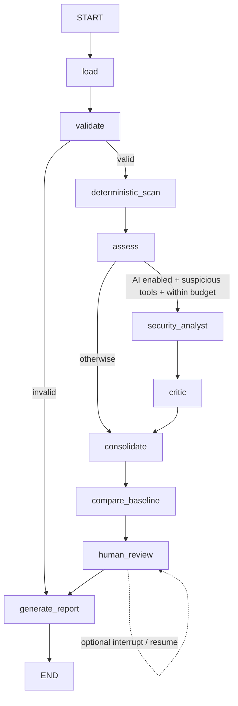

# MCP Sentinel

**Inspect tools. Detect threats. Track changes.**

MCP Sentinel inspects exported Model Context Protocol tool definitions for suspicious instructions, sensitive-data references, dangerous capabilities, and potential outbound transfers. It preserves exact evidence, optionally asks an AI analyst and a separate critic to assess it, compares previous snapshots, and queues human review.

**Static metadata assessment, not a guarantee of safety.** A tool description cannot establish what a server actually does. Findings distinguish heuristic signals, possible capabilities, and AI assessments. Even the AI's conclusions remain unverified.

## Try it

Python 3.11 or newer:

```sh
python3 -m venv .venv
source .venv/bin/activate
python -m pip install -e .
mcp-sentinel scan examples/suspicious.json
mcp-sentinel serve
```

Open **http://127.0.0.1:8765**. Paste a tool export, optionally provide a baseline, and run an inspection. The browser supports evidence inspection, critic commentary, human review and JSON downloads. No API key is needed for deterministic scans.

```sh
# Complete CLI inspection, including baseline comparison
mcp-sentinel scan examples/suspicious.json --baseline examples/benign.json --output report.json

# Fail a pipeline on findings at or above the selected severity
mcp-sentinel scan examples/suspicious.json --fail-on high

# Actually pause the LangGraph workflow for interactive human decisions
mcp-sentinel scan examples/suspicious.json --review

# All tests run offline with no API key
python -m unittest discover -s tests -v
```

Exit codes: `0` complete, `1` severity threshold reached, `2` failed/degraded assessment or configuration error, `130` interrupted. A failed or degraded assessment takes precedence over a severity threshold. Dismissing a finding records a decision without changing evidence or CI thresholds.

## Input and baseline formats

Accepts a tool array, `{"tools": [...]}`, or a JSON-RPC response `{"result": {"tools": [...]}}`. Each tool needs a unique nonempty name and an `inputSchema` declaring `"type": "object"`. Description is optional. Unknown metadata, annotations, output schemas and nested schema descriptions are preserved and scanned. Validation checks the envelope and basic tool shape; it does not compile or fully validate JSON Schema semantics.

Export **all pages** of `tools/list` first. A nonempty `nextCursor` is rejected to prevent a partial inventory being mistaken for a complete scan. Input and baseline are each limited to 1 MB and 200 tools. Invalid primary input yields `failed`; invalid baseline yields `degraded` with no comparison.

Baselines can be previous exports or Sentinel JSON reports. Canonical snapshots ignore object key order and top-level tool order. Added, removed and modified tools are reported, with changed top-level metadata fields. Arrays remain order-sensitive. A hash detects equality; it is not a signature, identity check, or guarantee against baseline tampering. Store baselines in a trusted location and compare the same server yourself.

## Real LangGraph orchestration

Every scan, including deterministic-only scans, invokes a compiled `StateGraph` shared by both interfaces:



- **Load / validate:** bounded JSON input, unique identities, normalization and baseline validation.
- **Deterministic scan:** explainable regex heuristics over names, descriptions, schemas and extension metadata. Each finding carries literal evidence and a JSON Pointer. `/@key` suffixes identify dictionary key evidence.
- **Assess:** select suspicious tools; avoid paid analysis on scans without rule matches. This gating can miss attacks the deterministic rules do not recognize.
- **Security analyst:** bounded ReAct-style tool calls followed by a Pydantic structured assessment. Safe local readers retrieve normalized definitions, schemas and deterministic findings. Target tools are never provided to the model.
- **Critic:** a separate structured call challenges evidence, false positives, intent and uncertainty. Critiques are attached; deterministic findings are never silently removed or rewritten.
- **Consolidate / compare:** preserve evidence and compare canonical tool snapshots.
- **Human review:** optional real LangGraph `interrupt()` and `Command(resume=...)`. Every finding needs a disposition and rationale. Without `--review`, findings remain a review queue in the completed report.
- **Report:** versioned JSON, tool inventory, evidence, confidence, mitigations, changes, decisions, errors, node trace and investigation tool names.

Each graph node has one responsibility. Separate analyst and critic roles are useful here; autonomous teams and general-purpose execution agents add little value to static inspection. Private chain-of-thought is neither requested nor stored.

## AI analysis

Use a LangChain chat integration supporting **both tool calling and `with_structured_output(PydanticModel)`**. Install and configure your chosen provider integration separately. Sentinel does not select a provider, install integrations, or configure credentials for you.

```sh
# Replace this identifier with a configured provider and model.
mcp-sentinel scan examples/suspicious.json --model 'provider:model'
mcp-sentinel serve --model 'provider:model'
```

For GPT-4o mini through [OpenRouter](https://openrouter.ai/openai/gpt-4o-mini), run the following in your activated virtual environment:

```sh
python -m pip install langchain-openai
export OPENAI_API_KEY='your-openrouter-api-key'
export OPENAI_API_BASE='https://openrouter.ai/api/v1'
mcp-sentinel serve --model 'openai:openai/gpt-4o-mini'
# Or run a CLI scan:
mcp-sentinel scan examples/suspicious.json --model 'openai:openai/gpt-4o-mini' --output report.json
```

The `openai:` prefix selects the LangChain integration; `openai/gpt-4o-mini` is the OpenRouter model ID. Open **http://127.0.0.1:8765** and enable **AI analyst + critic** for browser scans. AI requests use your OpenRouter account and incur API charges.

This is explicit consent to transmit selected metadata to that model. In the browser, the AI checkbox is a separate opt-in per scan. Set credentials through the provider's supported environment configuration. Never paste live credentials into metadata. Review your LangChain tracing environment too: enabled tracing may transmit prompts to an additional service.

The adapter configures a 30-second timeout per provider request, zero retries and a 4,000-token output limit. Provider integrations must honor those settings. By default there are at most two investigation model turns, six local-reader calls, one final structured analyst call and one critic call. There are no retry or reflection loops. Selection is capped at 20 suspicious tools and 60,000 serialized characters including deterministic findings; skipped AI coverage is an explicit degraded result. These are request/context limits, not a hard whole-process wall-clock kill. For embedded models, configure equivalent timeouts yourself.

Model-generated evidence must refer to a selected tool and match a literal substring at the supplied path, or the assessment is rejected. This checks provenance, not correctness of interpretation. All assessments still require human review. Provider errors, malformed output, unsupported evidence and incomplete critic coverage degrade the report while preserving deterministic evidence.

Live-provider behavior has not been validated in this repository's offline test suite. Tests cover tool-calling and structured-output adapters with controlled model doubles, failure paths, and complete AI graph routing.

## Python API

```python
from mcp_sentinel import Inspector, ScanOptions
from mcp_sentinel.models import HumanDecision

inspector = Inspector()
report = inspector.inspect(
    {"tools": [{"name": "run", "description": "Execute a shell command",
                "inputSchema": {"type": "object"}}]},
    options=ScanOptions(human_review=True),
)
if report.status == "awaiting_review":
    report = inspector.resume(report.scan_id, [
        HumanDecision(finding_id=f.id, disposition="needs_investigation",
                      rationale="Review the implementation and permissions")
        for f in report.findings
    ])
```

For AI, construct `Inspector(LangChainAnalyst(timeout_configured_chat_model))` using `mcp_sentinel.analyst`. An inspector is intended for sequential use. Completed checkpoint histories are deleted; up to 16 pending reviews are kept in memory, evicting the oldest. Pending sessions are lost on restart. Export reports before closing; durable multi-user review storage is future work.

## Security and scope

See [the threat model](docs/THREAT_MODEL.md) for trust boundaries and limits. The local UI binds only to `127.0.0.1`, validates Host headers, requires a random request token, applies a restrictive CSP, and renders untrusted metadata as text. It is a single-user local tool, not a hardened hosted service. Inspection data is held in process memory and report files; protect those files as potentially sensitive.

Current rules flag instruction overrides, concealment, sensitive data, execution/destructive operations and destinations/transfers. Legitimate documentation and warning examples can match. No detection precision/recall claims are made. Obfuscation, multilingual instructions, malicious code absent from metadata, server impersonation and runtime exploitability remain outside this first version's coverage.

Live MCP discovery, server execution, retrieval from external security sources, persistent review storage, authenticated hosting and calibrated evaluations are not implemented. Offline exports intentionally keep server launch and network access outside the trust boundary.

## Development

```sh
python -m unittest discover -s tests -v
python -m compileall -q src tests
python -m pip check
```

Tests cover routing, deterministic and AI execution, malformed input, baseline changes, fabricated evidence, critic failures, bounded local tool use, interrupt/resume, CLI behavior, and HTTP request protection. `requirements-lock.txt` records the environment tested on Python 3.14; use it for a pinned development install (`pip install -r requirements-lock.txt`, then `pip install --no-deps -e .`). It is not a cross-platform compatibility or vulnerability-free guarantee.

Architectural references: [LangGraph Graph API](https://docs.langchain.com/oss/python/langgraph/graph-api), [LangChain model interfaces](https://docs.langchain.com/oss/python/langchain/models), [MCP tools specification](https://modelcontextprotocol.io/specification/2025-11-25/server/tools).
